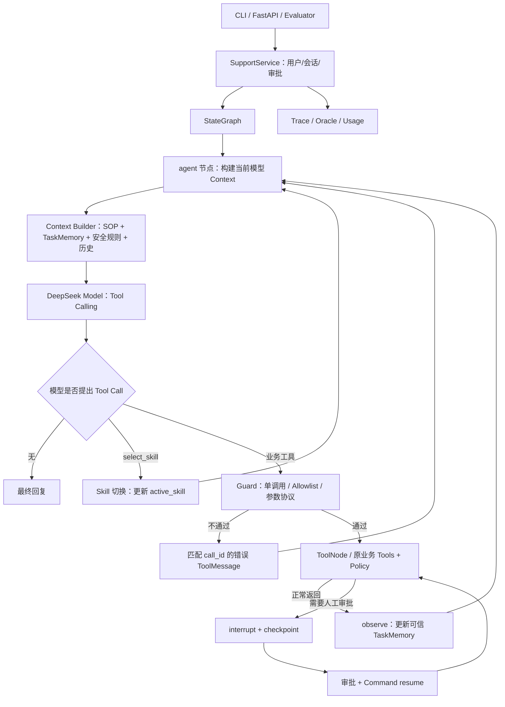

# SkillMem Agent V1 — 项目架构、目录规范与代码组织约束

**版本**：V1.0（2026-10-17）  
**用途**：给 Codex 的仓库目录与模块实现约束；作为 `SkillMem_Agent_V1_Implementation_Plan.md` 的配套文件  
**基础仓库**：[`nitanandsinghupw/langgraph-support-agent`](https://github.com/nitanandsinghupw/langgraph-support-agent)  
**固定上游提交**：`b6fe9faebff8a1af549ae7b8cabcb0b6e6479cec`  
**参考架构**：[`OWWZO/ai-agent`](https://github.com/OWWZO/ai-agent)，仅参考思想，不整体迁移 Java 实现

> 本文档是**目标目录与依赖契约**，不是项目已经完成改造的证明。原项目代码结构、测试结果以 2026-10-17 的 `agent_feasibility_report.md` 为事实依据；具体开发步骤、阶段 Gate、消融协议以配套《V1 实施方案》为准。若与实际源码冲突，Codex 必须记录证据并提交最小变更提案，不得无说明改写架构。

---

## 1. 架构原则：小而完整，而非重新造框架

1. **单 Agent**：一个决策模型（DeepSeek Tool Calling）；Skill Router、TaskMemory、Context Builder、Observe 都是同一个 Agent 的内部模块，不额外起 Planner Agent / Reviewer Agent。
2. **原业务优先复用**：保留 LangGraph `StateGraph`、8 个业务 Tool、原有 Policy、`interrupt/resume`、CLI/FastAPI；不重写业务成另一套框架。
3. **少文件、职责清楚**：在原 `src/support_agent/` 包内增量增加 `state.py`、`memory.py`、`context.py`、`skills.py` 四个核心文件；`planning.py` 仅当后期确有必要才创建。
4. **按模块依赖，避免环形调用**：`graph.py` 负责组装，`service.py` 负责会话与审批编排；`memory.py/context.py/skills.py` 不反向依赖 `service.py` 或 `graph.py`。
5. **业务事实可信来源**：LLM 可提出动作/用户意图，只有业务工具、Policy 及审批流程能产生“订单状态、退款成功、审批完成”等可验证事实。
6. **安全与恢复优先**：Skill 允许列表在**执行层**生效，不能仅靠缩减模型看到的工具；不能吞掉 LangGraph interrupt，也不能在异常时重放非幂等退款。
7. **完整历史与模型输入分离**：Checkpoint 留存完整 Messages；Context Builder 只负责组装下一轮发给模型的有限上下文。Trace 与结构化 TaskMemory 也不能互相代替。
8. **可比较、可审查**：B0/B1/M/MS 通过清晰开关或提交锚点区分；所有实验都留配置、commit、任务哈希与任务级结果。

### 1.1 V1 必须维护的主调用链



这个图是**目标设计**。原项目已实现 `agent ↔ ToolNode` 与审批中断；`Guard/observe/Context Builder/Skill 切换` 是待开发内容。

---

## 2. 推荐项目目录：严格控制文件增长

### 2.1 最终目标结构

`[原有]` = 主仓库已有文件；`[新增]` = 计划新增；`[更新]` = 保留文件名但需要局部修改；`[可选]` = 仅后期必要时引入。

```text
skillmem-agent/
├── README.md                          # [更新] 项目说明、快速运行、开源来源
├── LICENSE                            # [原有] 必须保留 MIT 版权声明
├── pyproject.toml                     # [更新] 依赖/可选extras/测试配置
├── .gitignore                         # [更新] 忽略密钥、DB、trace 原始文件
├── .env.example                       # [新增] 仅变量名和安全示例，不放密钥
├── requirements.lock                  # [可选] 或 uv.lock，二选一
│
├── src/
│   └── support_agent/                # 唯一业务/Agent Python package
│       ├── __init__.py                # [原有]
│       ├── __main__.py                # [更新] CLI 入口：参数、环境变量
│       ├── api.py                     # [原有/少量更新] FastAPI 路由
│       ├── service.py                 # [更新] 会话、线程串行、审批与图启动
│       ├── graph.py                   # [更新] StateGraph、Agent Loop、节点连线
│       ├── models.py                  # [更新] DeepSeek / offline 等模型工厂
│       ├── tools.py                   # [原有/少量更新] 8 个业务 Tool
│       ├── policy.py                  # [原有] 退款、取消的硬业务规则
│       ├── policies_kb.py             # [原有/可更新] 轻量政策检索
│       ├── store.py                   # [原有/可更新] 模拟订单及退款 Store
│       ├── offline_model.py           # [更新] 无网络协议与回归测试替身
│       ├── evaluate.py                # [更新] CLI 评测入口
│       │
│       ├── state.py                   # [新增] SupportState / TaskMemory 类型
│       ├── memory.py                  # [新增] 事实更新、去重、订单切换失效
│       ├── context.py                 # [新增] 模型输入组装、预算、成组裁剪
│       ├── skills.py                  # [新增] SkillSpec/Registry/动态选择/白名单
│       ├── evaluation.py              # [新增*] 评测 runner、oracle、统计
│       └── planning.py                # [可选 P2] 步骤状态逻辑过大才拆出
│
├── data/                               # 业务夹具与版本化评测输入，不是运行DB
│   ├── store.json                     # [原有] 模拟订单数据
│   ├── policies.md                    # [原有] 原业务政策
│   ├── scenarios.json                 # [原有] 11 个原始离线场景
│   ├── skills/                        # [新增] 业务 Skill SOP，仅 Markdown
│   │   ├── order_shipping.md
│   │   ├── refund.md
│   │   ├── cancel.md
│   │   └── policy_support.md
│   └── eval_tasks.json                # [新增] 冻结新增评测任务
│
├── tests/                              # 不搬走原项目既有测试
│   ├── conftest.py                     # [原有/更新] 公共隔离 fixture
│   ├── test_policy_and_tools.py       # [原有]
│   ├── test_conversations.py          # [原有]
│   ├── test_api.py                    # [原有]
│   ├── test_skills_memory_context.py  # [新增] 可拆开，但先小规模集中
│   ├── test_evaluation.py             # [新增] oracle/trace/usage/隔离
│   └── test_reliability.py            # [可选] 审批/幂等案例多时再创建
│
├── docs/
│   ├── architecture.md                # [新增] 本文档在仓库内的维护版本
│   ├── evaluation_protocol.md         # [新增] 冻结的评测集/实验配置/指标
│   ├── limitations.md                 # [新增] Demo 安全边界和未覆盖场景
│   └── reports/
│       ├── phase_0.md                 # Stage 0：基础环境/上游基线
│       ├── phase_1.md                 # Stage 1：DeepSeek/评测器
│       ├── phase_2.md                 # Stage 2：安全统一基线
│       ├── phase_3.md                 # Stage 3：Memory/Context
│       ├── phase_4.md                 # Stage 4：Skill
│       ├── phase_5.md                 # Stage 5：正式消融
│       └── final_review.md            # 完成后综合审查报告
│
├── artifacts/                           # [新增] 仅允许脱敏、可公开的少量摘要
│   ├── summary.json                    # 实验结果统计（生成后才存在）
│   └── results.csv                     # 任务级脱敏结果（生成后才存在）
│
└── .local/                              # [本地忽略] 绝不提交，按需创建
    ├── runs/                           # 原始 JSONL 轨迹、完整 Tool 输出
    ├── db/                             # SQLite checkpoint/测试业务DB
    └── secrets/                        # 如需临时敏感文件；通常只用环境变量
```

`evaluation.py` 标有 `*`：如果 `evaluate.py` 体量很小，也可以先只在原文件补 runner；一旦涉及复杂 Oracle、隔离、统计逻辑，再抽出 `evaluation.py`。**同一功能只应有一个权威实现**，禁止 `evaluation.py` 与 `evaluate.py` 同时各维护一套判定算法。

### 2.2 为什么不拆出更多目录？

- 不新增 `core/`, `domain/`, `infrastructure/`, `framework/`, `agents/` 多层空壳；原项目业务总共约千行 Python，过度分层会增加跳转和循环依赖。
- 不新建第二个 `skillmem_agent/` Python 包；继续复用 `support_agent` 以降低测试和入口迁移成本。对外产品名称仍叫 **SkillMem Agent**。
- 不在仓库里包含 OWWZO 的 Java 全量源码、演示前端或重复缓存的研究克隆；保留原项目 Git 来源和报告链接即可。
- `data/` 是版本化的固定输入；用户会话/生产态订单数据不能当静态 JSON 写回 `data/`。
- `artifacts/` 只提交适合公开的汇总数据，完整日志在 `.local/` 或经审查的外部存储，不得默认把用户文本或 Key 推到 GitHub。

### 2.3 Stage 0 目录要求

**Stage 0 不提前创建一堆空业务模块。** 最少只创建：

- 复用原有 `src/support_agent/`、`tests/`、`data/`、`LICENSE`、`pyproject.toml`。
- 增加 `docs/architecture.md`、`docs/reports/phase_0.md`、`.env.example`、`.gitignore` 与必要依赖锁定文件。
- `state.py`、`memory.py`、`context.py`、`skills.py` 等到对应阶段再创建，且必须同时提交测试；不写占位类冒充实现。

---

## 3. 每个模块只能负责什么：边界与禁止事项

| 文件 | 唯一主职责 | 可依赖谁 | 不应该出现的内容 |
|---|---|---|---|
| `api.py` | HTTP 请求/响应、演示鉴权输入 | `service.py`、请求模型 | Tool 实现、Policy 规则、LLM Prompt、业务状态写入 |
| `__main__.py` | CLI、运行配置 | `service.py`、`models.py` | Agent 循环、评测统计规则 |
| `service.py` | `SupportService`、会话归属、线程串行、审批编排、graph invoke/resume | `graph.py`、`store.py`、`policy.py`、registry | Skill SOP 内容、TaskMemory 提取算法、token 裁剪循环 |
| `graph.py` | `build_graph`、Agent 节点、控制路由、guard/observe 节点组合 | `state.py`、`context.py`、`skills.py`、`memory.py`、原 Tool | 各类 Store 数据库读写实现、API 路由、评测报告 |
| `models.py` | 不同 provider 的模型构造和参数配置 | LangChain 模型适配 | 图流程、业务工具执行、Token 指标聚合 |
| `tools.py` | 对模型暴露的业务 Tool 及业务返回结果 | `store.py`、`policy.py`、`policies_kb.py` | 动态上下文摘要、任务统计、模型多轮控制 |
| `policy.py` | 确定性的业务硬约束 | 必要的业务数据类型 | 由 LLM 自行决定退款权限、会话 Memory |
| `store.py` | 订单、退款、工单的模拟业务状态及原子操作 | 数据类型和持久化驱动（若采用） | Agent 规划、Prompt、Skill Routing |
| `state.py` | JSON-safe LangGraph State/TaskMemory Schema | `MessagesState` 等类型 | 网络、数据库、模型调用或业务副作用 |
| `memory.py` | 从可信 Observation 更新 TaskMemory、去重、失效 | `state.py`、消息类型、纯数据处理 | 直接退款、向模型发请求、删 checkpoint 全历史 |
| `context.py` | 构造下一次 LLM 请求的预算内消息视图 | `state.py`、Skill 元数据、消息类型 | 修改业务 Store、永久删除 State.messages、LLM 训练 |
| `skills.py` | Skill 元数据、SOP 映射、Tool 允许列表/选择协议 | Tool 名称清单、Skill 文件路径 | 实际退款执行、客户授权决策、第二个 Router 模型 |
| `offline_model.py` | 无付费模型的固定行为/协议测试 | LangChain 消息协议 | 假装模拟真实模型成功率、绕过 guard |
| `evaluate.py` | 用户调用的评测命令入口 | `evaluation.py`（如拆出） | 大量重复 Oracle 或复制生产业务规则 |
| `evaluation.py` | case runner、业务 Oracle、轨迹/usage 汇总 | `service.py`、fixture、结果格式 | 隐式优化 Agent、生成假指标、改生产数据 |

**要求 Codex 在每个阶段报告中，为新增模块指出 2～5 个核心函数。** 若任一模块持续增长到约 300～400 行以上，优先分析职责是否混杂，再考虑按功能拆分；这只是审查提醒，不是为了行数强制拆文件。

### 3.1 明确依赖方向

```text
入口层 (api.py / __main__.py / evaluate.py)
            ↓
应用编排层 (service.py / evaluation.py)
            ↓
Agent 组装层 (graph.py) ──────────────→ 模型适配 (models.py)
       ├──→ State (state.py)
       ├──→ Memory (memory.py)
       ├──→ Context (context.py)
       ├──→ Skills (skills.py)
       └──→ Tool 执行 (tools.py) ─────→ Policy / Store / PoliciesKB
```

`evaluation.py` 调用 `SupportService` 而不是绕过 Service 直接捏造 Agent 行为。`memory.py` 与 `context.py` 尽量采用**纯函数、显式输入输出**，便于单元测试和无网络复现。

### 3.2 公共契约，不随阶段任意改变

- `customer_id`：仅从可信 `RunnableConfig` / Service 会话上下文获得；不从模型参数或自然语言文本取得身份权限。
- `thread_id`：唯一标识一个 Agent 会话；同一 `thread_id` 的调用必须串行化，避免 Graph State 与审批竞争。
- `tool_call_id`：Tool Request 与 Tool Result 的配对键；裁剪、Skill 切换、错误反馈都不能丢失配对。
- `active_skill`：LangGraph State 中存 Skill ID；从某个 Skill 切换到另一个 Skill 之后，下次模型请求必须使用新 SOP 和工具允许列表。
- `TaskMemory`：保存任务焦点、约束、可信已验证事实、来源 ID、进度；不可装完整原始对话/工具长日志。
- `checkpoint`：保存完整会话状态；Context Builder 不对其作破坏性修改。
- `approval`：以 LangGraph interrupt/checkpoint 与 Service registry 为可信来源，不能由模型或摘要文字直接标记 approved。
- `policy`：既有硬规则始终生效；Skill/SOP 只是引导模型，不改变权限边界。

---

## 4. 模型调用与上下文组装顺序

调用模型前由 `graph.agent()` 统一组装，严禁散落在工具/Service/路由器里重复拼 Prompt：

1. 固定 **System Safety Policy**：身份、退款、审批、不可越权等常驻安全边界。
2. **Skill Index**：所有 Skill 的短描述、`select_skill` 使用协议。
3. **Active Skill SOP**：仅当前 Skill 的业务流程；无 Skill 时不盲目加载全部流程。
4. **TaskMemory Projection**：当前订单、已确认约束、可信工具事实、待补问题、必要审批信息。
5. **Recent Messages / Completed Tool Groups**：从完整 checkpoint 中挑选最近交互；长结果提取关键字段。
6. **Bound Tool Schemas**：当前 Skill 的允许工具 + 公共工具，必须计入输入预算。
7. **Output Reserve**：预留回复 Token 及安全余量；未满足预算时显式错误或升级人工。

```python
# 这是职责分配伪代码，不是当前仓库已存在的 API。
context_view, diagnostics = build_model_context(
    state=state,
    system_policy=system_policy,
    skill_index=skill_index,
    active_sop=current_sop,
    tool_schemas=bound_schemas,
    budget=config.context_budget,
    pending_approval=pending_approval,
)
model = model_factory.get().bind_tools(allowed_tools)
response = model.invoke(context_view, config=config.runnable_config)
```

**注意**：输入预算使用保守 Token 估算 + 实际 provider usage 校准，不能称为精确的 DeepSeek tokenizer 限制。B1 和 M/MS 必须保持固定模型及可比较请求预算。

---

## 5. 关键状态流：必须在代码与测试中一致

### 5.1 正常业务工具调用

`LLM → 业务 ToolCall → 执行前 Tool Allowlist/参数校验 → ToolNode → ToolMessage → observe → TaskMemory → LLM`。

- `observe` 只在工具正常返回后处理该轮新增的 ToolResult。
- `ToolMessage.tool_call_id` 和原始 `AIMessage.tool_calls[].id` 一一配对。
- 可信事实只能从 ToolResult / 审批结果推导，并记录 `source_tool_call_id`、`order_id`。
- `observe` 仅返回状态更新；不在里面直接重试或触发副作用。

### 5.2 Skill 切换

`LLM → select_skill(skill_id) → 生成对应 ToolMessage + active_skill 更新 → 下一轮重新绑定目标工具子集`。

- `select_skill` 本身不创建新的 LLM Agent。
- Tool Executor 执行前再次检查 allowlist；不能依赖模型不会猜到未暴露的工具。
- 如果同一模型响应提出多个工具调用，应对**每一个 call ID**返回协议闭合的错误工具消息，且此次不执行任何有副作用业务。
- 审批暂停期间不得切 Skill；用户改变订单后，旧资格事实需失效或按订单隔离。

### 5.3 大额退款与人工审批

`request_refund → 资格/金额再校验 → interrupt → 等待人工决定 → Command(resume) → 再校验 → 记录合法副作用 → observe`。

- 在 interrupt 前不能先写退款结果。
- pending 审批不能在 resume 失败时无恢复机制地丢失。
- 同订单重复请求、审批重试、超时重放必须通过幂等约束避免重复退款。
- 如果业务 Store 仍为内存，不得宣称业务状态跨进程恢复；若把“重启后可靠恢复”列为验收目标，必须连业务状态一起持久化。

### 5.4 历史裁剪与任务状态

- `Full Messages` 留在 checkpoint，`ContextView` 是模型请求使用的派生视图。
- 历史裁剪按完整工具对话组，不制造只有 ToolMessage 没有 AIMessage 的孤儿消息。
- 订单 ID、金额、币种、拒绝原因、当前审批状态等关键字段必须保留。
- 摘要是辅助上下文，不能覆写已验证事实；第一版不引入未经验证的“长期记忆库”。

---

## 6. 评测与运行产物：源代码和结果严格分离

### 6.1 目录分工

| 内容 | 唯一位置 | 版本管理规则 |
|---|---|---|
| 原始业务数据 / SOP / 冻结任务 | `data/` | 允许提交，记录内容哈希 |
| 测试及公共 fixture | `tests/` | 必须提交 |
| 项目架构 / 评测协议 | `docs/` | 必须提交 |
| 阶段证据报告 | `docs/reports/` | 必须提交，含 commit 和命令 |
| 少量脱敏实验统计 | `artifacts/` | 确认脱敏后提交 |
| 原始 JSONL 轨迹 / 运行 DB / token 日志 | `.local/` | `.gitignore` 忽略，不提交 |
| API Key / 人员凭证 | 环境变量或本地密钥文件 | 永不提交、不得出现在日志 |

### 6.2 数据集与实验变体

在同一个代码库中保留：

- `B0`：原作者功能行为基线，添加共同计量但不借修 bug 强化它；绑定固定上游 commit。
- `B1`：统一安全/审批/幂等/计量修复，仍全量工具 + 原历史策略。
- `M`：`B1 + TaskMemory + Context`。
- `MS`：`M + Skill Routing + Progressive Disclosure`。
- `MSP`（可选）：`MS + 显式步骤状态`。

主结论用 **B1 → M → MS** 的同任务、同模型、同预算配对比较；B0 只作为来源/能力边界参考。若 MS 增加业务 SOP，应单独比较“全量相同 SOP 注入”的 B1 对照，避免不公平。

### 6.3 评测器与 Trace 的最小输入输出契约

**输入任务（版本化）**至少包含：`case_id`、`category`、`customer_id`、`fixture`、`clock`、`turns`、`approval_script`、`expected`。

**单任务输出（脱敏后）**至少包含：`case_id`、`variant`、`repeat`、`git_sha`、`model_config_hash`、`dataset_hash`、`status`、`task_success`、`sop_compliance`、`tool_proposed_count`、`tool_executed_count`、`skill_switch_count`、`input_tokens`、`output_tokens`、`latency_ms`、`failure_reason`。

**原始 Trace（本地）**至少含：`run_id`、`thread_id`、`step`、`active_skill`、`tool_call_id`、`tool_name`、参数/结果脱敏摘要、`interrupt/resume` 事件、状态变更、usage 来源、停止原因。

评测规范如下：

- `Tool 提议次数` ≠ `Tool 实际执行次数`；拒绝、失败、重试需分别计数。
- 任务成功率应看业务最终状态和必要信息传达，不依赖唯一 Tool 调用序列。
- Token 必须按真实 provider usage 汇总**所有**模型调用（包括选 Skill 与可选摘要），缺失 usage 为 `unknown`，不能填 0。
- 每个案例/实验版本/重复都使用独立 Store、thread_id、临时 DB；日期、任务和审批脚本固定。
- 评测 runner 必须在某任务失败后继续处理其他任务；完成后按配置产生非零退出码。
- 原 24 个 pytest 与 11 个离线场景始终作为回归门禁，但不能当真实 DeepSeek 的成功率。

---

## 7. 分阶段修改许可表（Codex 不得跨阶段抢跑）

| 阶段 | 可新增/主要修改 | 必须保持 | 本阶段交付 |
|---|---|---|---|
| **Stage 0** | README、LICENSE来源说明、依赖锁、`.gitignore`、`docs/` | 原 `src/` 业务/图逻辑不改 | 可复现原 24 + 11，`phase_0.md` |
| **Stage 1** | `models.py`、`evaluate.py`、可选 `evaluation.py`、测试/评测数据 | 原 Tool/Policy/Graph 行为基本不变 | DeepSeek mock + 基线追踪/usage/Oracle |
| **Stage 2** | `service.py`、`graph.py` guard、必要 `tools.py/store.py`、可靠性测试 | 共享 B1 安全能力，不提前写新 Memory/Skill 效果 | 幂等/审批/多调用协议 Gate |
| **Stage 3** | `state.py`、`memory.py`、`context.py`、`graph.py`、测试 | B1 可单独运行，原 checkpoint 历史保留 | 长上下文/事实来源/预算 Gate |
| **Stage 4** | `skills.py`、`data/skills/`、`graph.py`、离线协议测试 | Policy、订单 Tool 语义、Approval 恢复不被破坏 | 四 Skill 动态 schema/allowlist Gate |
| **Stage 5** | `data/eval_tasks.json`、`evaluation.py`、结果/报告、可选 `planning.py` | 不改 Frozen Final 任务答案/不隐藏失败 | 配对消融与最终 GitHub 报告 |

如果后期确实需要打破该表，Codex 应先提交一段明确说明：`动机 → 现有路径为何不够 → 最小替代目录/接口 → 兼容性影响 → 回归验证计划`，经确认后再实现。

---

## 8. 代码质量、接口与依赖约定

### 8.1 Python 约定

- Python 3.11/3.12；沿用项目既有格式与 `ruff` 检查；公开函数尽量有类型注解和简短 docstring。
- 环境变量只由模型配置/Service 入口读取，避免在 `memory.py/context.py` 中暗读进程环境造成测试不稳定。
- 用可验证的 TypedDict / dataclass / Pydantic 定义数据；checkpoint State 字段保持 JSON-safe；禁止保存模型对象、连接、锁或 Callable。
- 在 `graph.py` 中注入依赖；不使用跨请求全局可变 `active_skill` 或 `current_order_id`。
- 原业务工具的 `RunnableConfig` 客户身份约定保持不变。
- 可以用少量函数解决的问题不新建基类体系、事件总线、复杂插件发现器或通用服务容器。

### 8.2 配置约定（拟新增变量，实施时统一文档）

| 环境变量 | 用途 | 要求 |
|---|---|---|
| `SUPPORT_MODEL_PROVIDER` | `offline` / `deepseek` 等 | 默认可离线测试；不要在 CI 强制联网 |
| `DEEPSEEK_API_KEY` | DeepSeek 凭证 | 仅环境变量，不写入配置仓库 |
| `DEEPSEEK_MODEL` | 模型名称 | 可配置，实际可用性以运行时验证为准 |
| `DEEPSEEK_BASE_URL` | API 地址 | 默认官方地址，测试可覆盖 |
| `SUPPORT_DB` | 检查点 DB | 明确 CLI/API 是否都实际读取 |
| `SKILLMEM_VARIANT` | `B1` / `M` / `MS` | 实验必须记录有效值 |
| `SKILLMEM_CONTEXT_BUDGET` | 输入 Token 估算预算 | 配置清楚单位，避免与输出上限混淆 |
| `SKILLMEM_DATA_DIR` | 固定业务/Skill 数据根目录 | 默认定位可复现，不依赖不可预期 cwd |

以上 `SKILLMEM_*` 为**计划命名**，不是现有项目已识别的变量。Codex 实现后必须在 `.env.example` 与 README 保持一致，不要创建多个功能重叠的别名。

### 8.3 目录整洁检查清单

- [ ] 所有核心业务代码仍位于 `src/support_agent/`，没有多套重复 package。
- [ ] `docs/architecture.md` 与 README 的目录图、实际文件一致。
- [ ] 新增目录都承载实际代码/数据；不允许大批空目录和空模块。
- [ ] `memory.py` 不请求模型，`context.py` 不修改业务状态，`skills.py` 不操作退款数据。
- [ ] Graph 的 Guard/Tool/Observe 可清晰定位，单 Agent 链路容易画出。
- [ ] 原回归测试不搬走、不删除；新增测试可单独运行。
- [ ] `.local/`、`.env`、`*.sqlite`、凭证、完整原始 trace 已忽略。
- [ ] `README` 的任何“已实现”“提升”都能指到代码、测试或实验结果。
- [ ] 上游 MIT LICENSE、原仓库链接与改造说明均保留。

---

## 9. Codex 每阶段必须回传的目录与架构审查内容

除《V1 实施方案》要求的 `docs/reports/phase_N.md`，还应附上：

1. **目录树**：`git ls-files` 派生的变更后目录树，并标注本阶段新增/修改/删除文件。
2. **模块职责表**：每个本阶段新增文件的入口函数、入参/出参、依赖方向；解释没有引入循环依赖。
3. **控制流说明**：Graph 边与 State 更新点；若触及审批，附 interrupt/resume 时序。
4. **测试证据**：运行命令、通过/失败数、关键边界测试；不能用 README 截图代替。
5. **未实现或未验证项**：例如真实 DeepSeek、跨进程业务 Store、中文政策、新 Planner 等，逐项明确。
6. **Gate PASS/FAIL**：不满足 Gate 则停止后续阶段开发并列出阻碍。
7. **Git 信息**：branch、commit SHA、推送后的确切 GitHub URL；没推送成功不要杜撰链接。

### 9.1 建议的阶段报告补充段落

```markdown
## Architecture & Directory Audit
- Current tracked tree: [paste or attach]
- Added files / removed files / relocated files:
- New functions and module dependencies:
- State schema diff / migration:
- Graph nodes and edges diff:
- Baseline behavior preserved? How verified:
- Architectural deviations from the approved design:
- Directory/duplicate-code checks:
- Known gaps and next-phase blockers:
```

---

## 10. 给 Codex 的执行指令（需同时阅读两份规范）

> 在每个 Stage 开始前同时阅读《SkillMem Agent V1 实施方案》和本《项目架构与目录规范》。功能范围与验收 Gate 依实施方案，目录/职责/依赖边界依本文档。**只执行当前 Stage，结束后提交 Git commit 与 `docs/reports/phase_N.md`，附 Architecture & Directory Audit，等待审查确认再进行下一阶段。** 不以“简历描述需要”作为添加未测试功能的理由，不修改上游研究快照，不上传密钥/未经脱敏数据。遇到规范冲突或实际源码不符，先报告证据与最小替代设计，不擅自扩散改造范围。

## 11. Stage 3 已实现边界（目标规范之上的状态记录）

截至 Stage 3，新增 `state.py`（SupportState/TaskMemory）、`memory.py`（用户约束与可信观察）、`context.py`（预算内模型输入视图）；前三阶段的业务/审批实现仍复用。B0/B1保持独立，M新增 `tools → observe → agent` 边。Service只读取配置和可信审批快照，提取/裁剪算法不进入Service；Graph组装，不复制业务Policy。

用户明确订单焦点不能由非当前订单工具结果覆盖。Observation身份由提议AI消息ID与tool_call_id组成，既支持恢复去重，也兼容后续响应复用供应商call ID；冲突结果使对应事实失效。仅工具Observation形成可信事实，用户目标/约束均标明来源与未验证属性。审批投影从registry/interrupt取得，并与完整checkpoint中的对应完成ToolMessage核对。

M的三个上下文策略只影响模型输入，完整Messages保留。估算使用UTF-8字节与消息封装余量，计入System、Schema、任务投影、历史、输出与余量；不是精确计费tokenizer。B1仍使用原40消息策略。未知旧checkpoint字段采用安全默认值，旧观察不得覆盖最新用户焦点或完成新任务。历史旧B0业务数据库仍遵守Stage 2的拒绝自动迁移限制。

必要接线修改包括Service变体/配置、Evaluation配置元数据、Tracing估算与真实usage关联、离线验证脚本临时数据库隔离；没有新增框架或依赖。`service.py`超过原行数提醒阈值，仍包含既有registry与审批编排，暂不为行数强制拆分。Skill/Planning在本阶段尚未实现。

## 12. Stage 4 已实现边界

MS复用M和B1执行层，新增`skills.py`与`data/skills/{order_shipping,refund,cancel,policy_support}.md`。Registry保存固定ID、描述、SOP路径/文本及业务工具集合；模型输入只注入当前SOP。每轮Agent重新绑定允许业务工具与公共`select_skill/escalate_to_human`；Guard独立复核allowlist，不能通过猜工具名绕过。

`select_skill`是同一模型的控制工具，输出匹配ToolMessage并更新active_skill；不创建第二Router模型，不改订单业务权限。审批期间冻结；完整checkpoint确认终态后同次恢复中可继续切换。旧B1/M待审批迁入MS时，只为精确匹配可信审批消息/调用/订单的原退款恢复refund Skill，单独记录skill.restored，不伪造模型路由。

B1/M的full_sop显式对照注入与MS相同的四份SOP，并说明所有业务工具已开放、不执行选择指令；默认不变。MS拒绝full_sop。Tracing分开记录业务入口、控制入口、切换、所有模型usage与路由响应usage子集；格式错误但能识别select_skill的响应也计路由成本，缺usage不补零。离线规则模型只增加绑定select时的协议演示，不是Skill效果评测。
