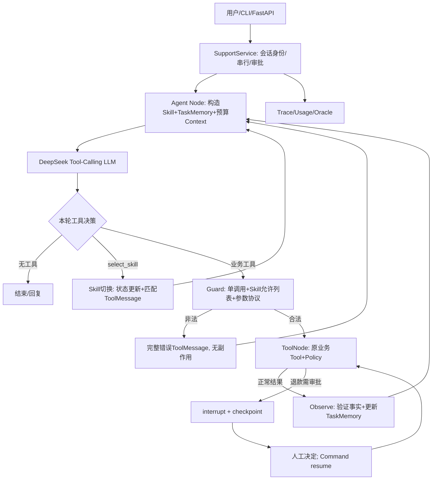

# SkillMem Agent V1 — 架构改造、分阶段开发与评测实施规范

**版本**：V1.0 · 2026-10-17  
**性质**：交付给 Codex 的实施规范（尚未实施的功能一律为设计目标）  
**主项目**：`https://github.com/nitanandsinghupw/langgraph-support-agent`，调研固定提交 `b6fe9faebff8a1af549ae7b8cabcb0b6e6479cec`  
**参考项目**：`https://github.com/OWWZO/ai-agent`，调研固定提交 `09d002baba7b6bd5701949635ec325ffee5ccbae`  
**源报告**：`agent_feasibility_report.md`（Codex 2026-10-17 源码/离线测试报告）  
**配套目录规范**：`SkillMem_Agent_V1_Project_Architecture.md`（目录、模块职责、依赖边界、阶段目录审查）

> 项目定位：**基于 Skill 动态路由与结构化任务记忆的单 Agent 电商售后系统**。重点展示 Agent Loop、Tool Execution、Skill Progressive Disclosure、Task Memory、Context Engineering、可靠执行和 Agent Evaluation。底层模型使用 DeepSeek API；不做 SFT/RL、多 Agent 或复杂前端。复用开源代码需保留原仓库 MIT 许可证与适当署名。未做过的功能、测试和数值不得写成已实现成果。

---

## 0. 已核实事实与项目边界

### 0.1 调研确认（非规划）

- 主仓库 26 个 Git 跟踪文件；Python 16 文件/1303 物理行，其中 `src/support_agent` 12 文件/1026 行，测试 4 文件/277 行；`graph.py` 56 行。
- 有 8 个业务工具：`list_my_orders`、`get_order`、`track_shipment`、`check_refund_eligibility`、`request_refund`、`cancel_order`、`search_policies`、`escalate_to_human`。
- `MessagesState`、LangGraph `StateGraph`、`ToolNode`、SQLite checkpoint、退款大额 `interrupt/resume` 已存在。消息裁剪的 `max_tokens=40, token_counter=len` **实际上按消息条数**，非真实 token。
- 基于离线规则模型，原版 `24 passed`、11/11 单轮场景通过；不代表真实 LLM 效果。报告覆盖率约 88.79%（语句）。
- 原版模型有 `offline/openai/azure`，**没有 DeepSeek provider**。本地模拟协议下，非思考 Tool Calling 和 `tool_call_id` 链路通过；真实 DeepSeek API 未调用。
- 原版业务 Store 进程内存保存，checkpoint/审批注册为 SQLite；存在跨重启业务状态丢失、审批领取后恢复失败丢待审、多调用/审批边界、缺少任务记忆、中文政策检索缺失等问题。默认 `X-Customer-Id` 是演示型身份，非生产鉴权。

### 0.2 V1 的“必须”和“不做”

**必须：** 原业务回归；真实 DeepSeek Tool Calling；任务级轨迹/Token/成本测量；结构化 Task Memory；保留完整 checkpoint 但构造预算内模型输入；Skill 注册/按需 SOP 与工具 Schema；合法工具校验；审批中断与恢复回归；配对评测与消融。

**可选（须以数据决定）：** 简单任务步骤状态；LLM 摘要；跨重启的订单/退款业务持久化；中文政策检索别名（若中文评测则强制做）；多次失败后的人工升级策略。

**不做：** 多 Agent、RAG 向量检索、复杂 Planner LLM、MCP 服务市场、业务级支付接口、SFT/RL、本地 GPU 部署、前端/UI 重做、声称生产安全。

**明确非目标：** 不把 8 个工具的 Skill 化预先承诺为降本；额外路由可能比减少 Schema 更贵。对照实验不支持时应报告负结果并保留更简单设计。

---

## 1. 第一版目标架构（单 Agent）



**关键架构决定：**

1. 只有**一个 LLM Agent**；Skill Router、Context Builder、Observe、Task State 都是同一个 Agent 的内部组件。无需第二个 Planner 模型。
2. 保留原 `SupportService → StateGraph → agent ↔ tools` 交互模式；扩展 `SupportState`，加单一 `observe` 节点，避免修改业务工具核心逻辑。
3. **持久化完整消息**以审计、恢复；上下文压缩只改变“发给模型”的视图，不删除 checkpoint；TaskMemory 不重复存储完整工具输出。
4. 业务事实必须由 Tool/审批产生；LLM 或用户表述只能产生待确认信息，不能直接写 `verified_*`。
5. `GraphInterrupt` 绝不能当普通工具异常吞掉；对于退款等有副作用操作，不允许因 API 失败盲目重放。
6. 基础版本限制一次模型响应最多 1 个工具调用：若收到多个调用，则逐个返回匹配 `tool_call_id` 的错误 `ToolMessage`，不执行任何副作用，提示分步重试；不默默忽略部分调用。

### 1.1 配置与实验变体

建议单代码库、多组开关：

- **B0 Original-compatible**：原作者提交的业务/控制逻辑，仅追加相同 DeepSeek 适配和观测仪表，不改变能力行为。以固定 Git commit/tag 可追溯，保留源快照。
- **B1 Common-safe baseline**：使用相同的可靠性修复、评测日志、请求预算和异常规范，但仍然 **8 工具全量绑定 + 原 Message History 策略**，不使用新 TaskMemory、Skill Router 或 Context 优化。
- **M**：B1 + TaskMemory + 预算内 Context。
- **MS**：M + Skill 动态路由与按需 SOP/Schema。
- **MSP（可选）**：MS + 轻量任务步骤状态；**LLM 摘要另外作为可选开关**，不要混为同一个收益来源。

**核心优化结论来自 B1 与 M/MS 的配对对照**；B0 用于展示相对原项目的工程改造，不能把 B1 修复的 bug 算成 Memory/Skill 带来的性能改进。

---

## 2. 模块级技术规格与契约

### 2.1 SupportState 与 TaskMemory

新增 `src/support_agent/state.py`，使用继承 `MessagesState` 的 TypedDict（或与现有 LangGraph 版本兼容的等价结构）。建议字段：

```python
class SupportState(MessagesState):
    schema_version: int
    active_skill: str | None
    task: dict               # JSON-safe TaskMemory, 不放数据库对象
    context_summary: str | None
    observed_call_ids: list[str]  # 用于去重，长任务可改成有界集合/持久水位
```

`task` 的最小约定：

```json
{
  "task_id": "t-...",
  "goal": "request_refund",
  "active_order_id": "1001",
  "constraints": [{"key":"amount", "value":89, "source":"user", "confirmed":true}],
  "verified_orders": {"1001":{"status":"delivered", "source_tool_call_id":"call_..."}},
  "eligibility": {"order_id":"1001", "eligible":true, "source_tool_call_id":"call_..."},
  "last_tool_outcomes": [],
  "pending_action": null,
  "status": "in_progress"
}
```

**契约：**

- `customer_id` 不得成为模型可修改字段；只由可信 `RunnableConfig` 注入。
- 每条关键工具事实记录 `tool_call_id`、`order_id`、可用的观察时刻/业务版本；退款资格是**历史快照**，退款执行仍需调用原 `policy` 重验。
- 切换订单号必须使旧订单资格失效；用户改变金额、收货要求时，标记冲突/再次确认。对“用户称已退款”标记 `unverified`，不得覆盖工具事实。
- Tool 执行正常结束才在 `observe` 更新可信状态；`interrupt` 发生时没有正常的 ToolMessage，待审批信息从 graph interrupt / registry 可信映射取得。
- `observe` 依据 `tool_call_id` 只处理新结果，resume/replay 不重复记账；状态节点以返回更新对象写入 LangGraph，不在原 state 字典做隐式修改。
- 第一版只做会话内任务记忆，**不实现用户长期画像或向量长期记忆**。

建议 `src/support_agent/memory.py`：

```python
observe_tool_results(state, new_tool_messages) -> dict
merge_user_constraints(task, request, evidence) -> dict
invalidate_order_facts(task, new_order_id) -> dict
render_task_context(task, pending_approval) -> str
```

### 2.2 Skill Registry 与动态工具允许列表

新增 `skills.py` 与 `data/skills/*.md`。第一个版本使用 **4 个 Skill**：

| Skill ID | SOP | 允许的原业务工具 |
|---|---|---|
| `order_shipping` | 查订单、查物流、订单归属 | `list_my_orders`, `get_order`, `track_shipment` |
| `refund` | 退款资格、金额确认、审批 | `list_my_orders`, `get_order`, `check_refund_eligibility`, `request_refund` |
| `cancel` | 未发货取消与结果确认 | `list_my_orders`, `get_order`, `cancel_order` |
| `policy_support` | 政策咨询、升级人工 | `search_policies`, `escalate_to_human` |

`select_skill` 和 `escalate_to_human` 可作为公共能力；`select_skill` 是**同一个 LLM 选择的控制工具**，不是另调用一个 Router LLM。建议注册表：`SkillSpec(id, name, description, sop_path, tool_names)`。

执行规则：

1. 常驻 System 只包含安全边界、简短 Skill Index、`select_skill`/`escalate_to_human`，无需全量 SOP。
2. 当前 Skill 被选中后，下一次 Agent 调用才注入该 SOP 并仅绑定对应工具 Schema。`bind_tools()` 从建图阶段移动到 Agent 每次调用前；可缓存无用户数据的绑定 Runnable。
3. 不只限制**模型看见的 Schema**，执行前还必须做 allowlist 检查；`ToolNode` 若继续持有 8 工具，需要 guarded dispatch 包装，不能让模型通过猜测工具名越权。
4. 切 Skill 时给匹配 ID 的 ToolMessage，同时更新 `active_skill`；如果使用 LangGraph `Command`，保持 `add_messages` reducer 与中断语义。对非法 Skill、多个 tool_calls 返回明确错误，**不执行副作用**。
5. 审批等待/恢复期间冻结活跃 Skill，不擅自变更原 Tool 名/参数；切换订单时使旧资格事实失效。
6. Skill 路由次数、提示/Schema Token 和额外时延**全部计入成本**。如果消融不利，允许保留按需 SOP、放宽工具子集路线，不能宣称一定降本。

### 2.3 Context Engineering：预算模型输入，不删原历史

新增 `context.py`，核心纯函数：

```python
build_model_context(
    state, *, system_policy, skill_index, active_sop,
    tool_schemas, budget, pending_approval=None
) -> tuple[list, dict]  # 模型messages + budget/裁剪诊断
```

逻辑必须做到：

- 预算计入 System Policy、Skill Index、当前 SOP、TaskMemory 投影、**Tool Schema**、对话历史及输出 Token 预留、安全余量；禁止只统计 `messages`。
- 优先保留：最新用户请求、当前订单与已确认约束、未完成审批/动作、近几轮完整 Tool Call ↔ Tool Result。
- 裁剪历史必须按消息组进行；Assistant `tool_calls` 与对应全部 ToolMessage 同进同退，绝不制造孤立工具消息；保留 Tool ID 映射。
- Tool 输出长时，显示给模型的摘要只留下安全相关字段、订单号、金额、币种、拒绝原因、状态与必要证据，原始输出仍在 checkpoint/trace 中。
- 先用结构化事实投影 + 确定性历史裁剪；**LLM 摘要仅作为 P2 开关**。摘要不能覆盖结构化可信事实，失败回退确定性裁剪。
- 固定安全规则和最新请求本身超预算时抛显式 `context_budget_exceeded`/升级人工，不能偷偷删安全规则。
- DeepSeek 的 Token 计算不得假定与 OpenAI 完全相同。V1 使用保守预估 + 余量 + provider usage 校准，称作 **estimated context budget**，不要宣传硬 Token 上限。
- 每次保存上下文诊断：`estimated_input_tokens`、`actual_input_tokens|null`、`system/tools/history/task/skill` 各部分预算、丢弃消息组数、压缩原因、active_skill、版本号。

**注意**：模型响应与任务运行的请求次数、工具次数上限应该独立配置。新增 `observe` 节点会增加图节点计数，原 `recursion_limit=16` 不能不加分析就沿用，也不能设成无限。

### 2.4 Planning：轻量状态机优先

V1 不增加专门 Planner LLM，仅为退款等多步骤任务维护状态，步骤例如：`resolve_order → verify_eligibility → confirm_amount → request_approval_if_needed → execute_refund → inform_user`。步骤状态 `pending/running/blocked/done/failed`。

**必须基于工具执行结果/业务后置条件推进**，不能仅因模型输出“已完成”就置为 done。订单变更会失效旧资格；永久错误转人工；临时错误有限重试；只有真实 interrupt/registry 可标记 awaiting_approval。本模块独立开关，作为 P2 消融；若任务记忆已足够，第一版可不实现。

### 2.5 Tool Execution、安全与审批恢复

保持原 8 工具及业务 Policy，不需要重写订单/退款规则；但在共享 B1/O 基线上统一修复会影响结果可信度的缺陷：

- 同一 `thread_id` 串行处理，同一业务订单具备幂等防护。**模型请求重试与产生副作用的业务调用重试严格分离**。
- 大额退款在 `interrupt()` 前不修改业务结果；resume 后再检查资格和审批结果。
- 审批状态至少使用 `pending → resolving → resolved` 或等价“领取失败可恢复”事务；发生异常不能先删除 pending 再丢失。
- 对真实退款实现稳定幂等键（会话/业务请求/订单关联），并保证“每订单一次退款”的政策规则；测试重复 tool_call、失败后重试和 checkpoint replay。
- 原 Store 的订单/退款属于**内存状态**。如果 V1 不引入业务 SQLite 持久化，**禁止声称业务数据跨进程恢复或生产级可靠性**；跨重启恢复若作为成果，业务持久化+唯一约束必须提升为验收项。
- API `X-Customer-Id`、员工共享 Key 仅用于演示；README 必须声明不等于生产身份认证。
- 退款 SOP 中的“先显式资格查询”属于流程合规，原 `request_refund` 内已经有资格硬校验。评测应区分 **业务安全** 与 **规定工具顺序的 SOP 合规**，不能混淆。
- 识别 `GraphInterrupt` 并继续 LangGraph 标准处理；模型超时/429 可以在**无副作用的模型请求侧**有限重试，Tool 失败不能按模型超时策略盲重试。

### 2.6 DeepSeek 模型接入

在 `models.py` 中新增 `provider=deepseek`；默认 Model ID 配置化，连接 `https://api.deepseek.com`，使用 Chat Completions、**非思考模式**。Codex 应以调研报告的非思考示例为起点，重新核对当前官方参数；不要通过简单改模型名冒充兼容。

- `.env` 不是原项目自动加载的；从环境变量或显式配置注入 `DEEPSEEK_API_KEY`，禁止写入日志/提交仓库。
- Model/temperature/output tokens/timeout/retries/base_url 均配置化，模型版本、请求配置进入实验元信息。
- 测试：mock schema、tool_call_id、错误返回、usage；独立运行一次真实 API 的低预算 smoke，才能声称真实 DeepSeek 集成完成。
- 如未来开 Thinking Mode，必须重新解决 `reasoning_content` 回传、checkpoint 和摘要裁剪兼容问题；V1 不做。
- `usage_metadata` 优先，保留原始 `response_metadata.token_usage`，缓存 hit/miss 不重复计入总 Token；缺失 usage 标记 `unknown` 而不是 0。

---

## 3. 六阶段开发顺序与严格验收门禁

**总原则：** 每阶段只修改必要文件，先补单元/离线集成测试，再合并/继续。每个阶段提交一个或多个可追溯 Git commit，并生成 `docs/reports/phase_N.md`。任何红灯不得悄悄进入下一阶段。不要一次性让 Codex 完成全部功能。

### Stage 0：冻结上游与环境 / 基线盘点

**目标：** 让每个结果能回到确定代码与环境。

Codex 任务：

1. 基于主项目固定 commit 创建新工程；保留 LICENSE、README 来源与 upstream 地址；不要改动 `research/main-repo` 的取证快照。
2. 固定 Python 3.11/3.12 与可用依赖版本，建立 `pyproject.toml`/锁定文件或 requirements lock；设 `.gitignore` 忽略 Key、SQLite运行文件及原始敏感 traces。
3. 配置 `offline` 环境，复现 `pytest -q`、`python -m support_agent.evaluate`；记录 24 test/11 scenarios 的预期与实际、覆盖率、当前 Git SHA。
4. 保存 B0 upstream tag 与变更记录，标明 B0 不同于后来任何 B1 修复。

**验收 G0：** 离线 24/24、11/11；无秘密泄漏；具有可复现命令；提交 `phase_0.md`。

### Stage 1：DeepSeek 适配 + 评测基础设施（先计量）

**目标：** 不做 Skill/Memory 改动，先得到可解释的真实 Baseline。

Codex 任务：

1. `models.py` 增 DeepSeek 非思考模式，完成 schema 和 tool ID mock；不要用真实 Key 运行在 CI。
2. 统一 trace hook：每次模型请求的 input/output usage、Tool 提议/实际执行/异常、LangGraph interrupt/resume、最终业务 Store 快照差异。
3. 在 `evaluation.py` 或单个 runner 中实现：可重置 fixture、对话脚本、审批脚本、业务后置条件 oracle、每 case 独立 Store/DB/thread、失败不中断剩余 cases。
4. 单独保留原 11 个回归场景；新评测不以工具名称**精确顺序**取代业务成功条件。
5. 定义 `B0-compatible` 与统一测量模式，先跑 2～3 个简单的真实 DeepSeek smoke（在用户已提供 Key 和明确预算后）；如无 Key，状态写 `not_run`，不可写模型成功率。

**验收 G1：** 离线原测试全绿；mock 下 tool-call ID/usage/schema 正确；3 类业务 oracle 用可控脚本单测；runner 会保存 JSONL/summary；真实 API 状态清楚标注。

### Stage 2：统一安全基线 B1（所有变体共用）

**目标：** 避免通过修 bug 伪造 Skill/Memory 收益。

Codex 任务：

1. 同会话串行、执行限制（每次1 tool call）、非法工具无副作用且完整 ToolMessage 回应。
2. 审批 resume 失败可重试；对同一退款重复执行/重放增加幂等防护。
3. 分离真实工具**开始/成功**与 AIMessage 提议数；修正 evaluator 失败退出码。
4. 如以中文演示，增加政策关键词别名及测试；演示约束下不扩展完整 RAG。
5. 出于时间可保留业务内存 Store，但必须限制对“跨进程持久化”的宣称；如选择实现 SQLite 订单/退款持久化，则应有重启和唯一约束的双端测试。

**验收 G2：** 原场景通过；非法调用、超额、越权、重复退款、超过50欧审批、恢复失败、重复resume、同thread串行各有测试；全部 variants 共用 B1 代码；报告中清楚区分已测的 same-process 与跨重启保障。

### Stage 3：TaskMemory + Context 优化（核心贡献一）

**目标：** 将“近期对话+可信任务事实”作为有限预算上下文的主要策略。

Codex 任务：

1. 新建 `state.py`、`memory.py`、`context.py`，增加 `SupportState`、`TaskMemory`、`observe`。
2. 实现来自 ToolResult 的可信事实提取、来源标识、订单切换事实失效、工具结果去重；审批中断状态读取独立可信来源。
3. `build_model_context` 实现 System+SOP+tools+history+task+response reserve 预算；工具成组裁剪；可测试确定性摘要。
4. 增加 `full_history/legacy_trim/structured_memory` 控制开关；**不要删除 checkpoint 原消息**。
5. 写长上下文、消息配对、超预算、安全规则保留、订单信息跨轮保持和恢复相关测试。

**验收 G3：** 人工构造超长轨迹能真实触发裁剪；相同输入可重复构造 Context；无孤立 tool messages；旧 checkpoint 安全默认；状态事实来源可信；基线 B1 行为不受影响。

### Stage 4：Skill Routing + Progressive Disclosure（核心贡献二）

**目标：** 将业务 SOP/Tool Schema 从全量常驻改为按需暴露，不增加额外 Planner Agent。

Codex 任务：

1. 新增 `skills.py`、4 份 SOP；保留安全总规则的常驻注入。
2. 新增 `select_skill` 公共工具；改造 Agent Node 在每轮按 current Skill 动态 `bind_tools`。
3. 在执行层实现当前 Skill allowlist，处理不存在/无权限工具、多个 call、切换 Skill 期间的跨组 ToolMessage。
4. 实现跨 Skill 切换、模糊意图澄清、订单切换事实失效、审批状态锁定。
5. 与 Stage3 联通：Context 构造输入随 Skill/SOP/Schema 正确变化，并统计路由本身的 Token、延迟与调用数。

**验收 G4：** 4 Skill 的工具映射测试；越界不执行；所有 Tool Call 有匹配结果；切换后任务事实不错误沿用；审批不中断/漏执行；启用 Skill 的模型请求中只包含目标工具 Schema（除公共工具）；旧 B1/Memory-only 仍可独立运行。

### Stage 5：Planning 可选 + 配对实验 + GitHub 交付

**目标：** 测出可信的“成功率—合规性—成本”权衡，形成可供代码审查和面试准备的最终材料。

Codex 任务：

1. 如果确有需要，加入 3～5 步的轻量 `task.steps`，只由观察/业务后置条件推进；不是单独 Planner 模型；独立开关，可消融。
2. 完成 24～40 个新增多轮/长程/异常/安全任务（下面给出分布与样例）；固定任务集后再优化策略，不根据测试答案特判。
3. 真实 DeepSeek 同一配置评测 B1/M/MS（可选 MSP/摘要），每 task×variant 至少 3 次；记录成本和结果，无法运行则如实报告原因。
4. 生成图表、任务失败分类、消融对照；重点分析 Memory 保持是否与 Token 开销形成更好权衡，以及 Skill 对 8 工具场景到底带来净收益还是净成本。
5. README、Architecture、Benchmark Protocol、Limitations、License、复现脚本和 `docs/reports/final_review.md` 完备，经过授权后 push GitHub。

**验收 G5：** 回归测试全绿；真实模型所有任务都能得出可执行 oracle（包括失败项）；没有虚构 Token/成功率；不同 variant 用量与预算统计一致；基线/优化代码 SHA 和测试任务哈希齐备；GitHub 上有可审查代码与脱敏证据。

---

## 4. 评测协议（V1 冻结，不能事后改口径）

### 4.1 任务集合与隔离

保留原作者 11 个 offline 场景作回归，新增 **建议 30 个**分层任务：

| 类别 | 建议例数 | 主要检验 |
|---|---:|---|
| 基础单轮（订单/退款/政策） | 5 | 原业务完成功能 |
| 多轮指代/订单切换/条件组合 | 7 | TaskMemory、Planning |
| 长历史与高 Token Tool 输出 | 6 | Context 裁剪与保留 |
| Skill 切换/模糊需求澄清 | 5 | Skill Routing |
| 安全/异常/审批/失败恢复 | 7 | SOP、权限与可靠执行 |
| **共计** | **30** | |

- 写好案例后冻结 `eval_tasks.json` 和内容哈希，保留少量开发用例与独立 final 测试集；禁止根据 final test 实例硬编码成功路径。
- 固定演示日期、模型、API参数、Tool实现、初始订单 JSON、审批决策脚本、重试和调用预算、中文/英文比例；每个 case×variant×repeat 使用独立数据快照与 thread ID。
- 长上下文案例必须超过原 40 条消息或确实触发 Token Budget，不能用几条短消息声称验证压缩。
- 包含正向完成与**正确拒绝**任务，拒绝时要求无副作用、回复原因正确。

### 4.2 一个可执行任务用例的推荐格式

```json
{
  "case_id": "mem_refund_switch_order_01",
  "category": "multi_turn_memory",
  "customer_id": "customer_1",
  "fixture": "retail_v1",
  "clock": "2025-10-01",
  "turns": [
    {"role": "user", "content": "请查看我1001号订单是否可以退款"},
    {"role": "user", "content": "我改成处理1002号订单，先查物流"}
  ],
  "approval_script": [],
  "expected": {
    "no_refund_created": true,
    "final_focus_order_id": "1002",
    "forbidden_tools": ["request_refund"]
  }
}
```

示例中客户/订单/fixture 的具体取值**必须由 Codex 与真实测试数据对齐**；本段只规定测试结构，不代表已存在或可直接运行。

### 4.3 指标及计算口径

| 指标 | 定义 | 注意事项 |
|---|---|---|
| Task Success Rate | 完整成功任务数 / 全任务数 | 通过 Store 最终状态 + 必要回复事实判断；批准待审不等于退款完成 |
| SOP Task Compliance | 满足该任务全部适用硬/软SOP约束的任务数 / 适用任务数 | 标注各规则分母；安全规则不可与流程顺序混淆 |
| Unsafe Side Effects | 越权/超额/未经批准副作用次数 | 核心安全门禁；理想为0 |
| Average Tool Calls | 实际执行 Tool 次数 / 任务数 | 分提议/开始/成功/拒绝/异常/重试，Skill路由另列并计总开销 |
| Avg Input / Total Tokens | API 实际 usage 按任务累计均值 | 包括 Skill 路由与可选摘要；缺 usage 记 unknown，不记0 |
| Task Latency | 每项任务从首请求至完成的实际耗时 | 建议均值/中位数/P95，并说明网络波动 |
| Memory Retention | 指定记忆任务中保留早期约束的正确案例占比 | 业务状态与最终引用正确性联合判断 |
| Resume Reliability | 对应审批/失败恢复用例成功次数/总次数 | 必须注明 same-process 还是跨进程重启 |

离线 token 预估仅作为预算诊断；真正的简历 Token 改善必须采用同口径的 provider usage。统计总任务结果时，对失败任务不能直接丢弃，以免产生幸存者偏差。官方缓存命中若已计入 `prompt_tokens`，不得重复相加。

### 4.4 严格可比的消融

| ID | 实验设置 | 用途 |
|---|---|---|
| B0 | 原版控制策略 + DeepSeek适配/共同计量 | 展示原始版本能力边界，不作为优化归因主基线 |
| B1 | 共用安全修复 + 8工具全量 Schema + 原消息历史 | 主 Baseline |
| M | B1 + TaskMemory/Context 预算 | 测长上下文与记忆机制 |
| MS | M + Skill 路由/SOP按需加载 | 测 Skill 的净收益/额外成本 |
| MSP（可选） | MS + 轻量步骤状态 | 测 Planning 是否有独立价值 |
| MS+Summary（可选） | MS + LLM摘要 | 测摘要额外成本与效果 |

额外公平性实验：若 MS 新增了完整业务 SOP，B1 需要一个 **B1+同样SOP全量注入** 对照，排除“优化组拥有更多知识”的混杂；Skill 路由和摘要的额外模型调用必须计入 Token/延迟。

建议每任务每变体至少3次，交错运行以减弱服务波动影响。`temperature=0` 仍可能有非确定性；保留任务级配对结果、样本量、失败原因和置信区间（适用时）。

### 4.5 指标目标（仅工程验收期望，不是结果）

- **硬门禁：** 回归测试 100% 通过；无越权/未经批准退款；匹配工具协议、无无穷循环；审批异常能得到明确状态。
- **期望改进：** 长历史任务的输入 Token 消耗下降，同时 Memory Retention 和 Task Success 不明显降低；不要为追求 Token 降低牺牲关键业务正确性。
- **Skill 的保留条件：** 在固定任务集上有明确的正确性/Token/工具选择价值；若 8 Tool 小场景净负收益，允许保留“按需 SOP”但取消强制每轮 Skill 模型路由。
- **不预设提升数字**。如果性能负收益，先核对任务集、提示等价性、模型配置、额外路由调用与摘要丢事实，必要时缩小项目声称并如实报告。

---

## 5. GitHub 提交规则、报告目录与证据契约

建议仓库目录：

```text
skillmem-agent/
├── src/support_agent/          # 原业务和优化模块
│   ├── graph.py models.py tools.py policy.py service.py ...
│   ├── state.py memory.py context.py skills.py
│   └── evaluation.py           # 若评测器过大才拆文件
├── data/
│   ├── skills/                 # 4份SOP
│   ├── eval_tasks.json         # 冻结任务清单
│   └── store.json ...
├── tests/
│   ├── test_skills_memory_context.py
│   ├── test_evaluation.py
│   └── [原测试文件]
├── docs/
│   ├── architecture.md
│   ├── evaluation_protocol.md
│   ├── limitations.md
│   └── reports/
│       ├── phase_0.md ... phase_5.md
│       └── final_review.md
├── artifacts/                   # 小型匿名化结果摘要（大原始日志可Git LFS/本地留存）
│   ├── summary.json
│   └── results.csv
├── README.md LICENSE pyproject.toml
└── .gitignore
```

> 目录可微调，但`phase_N.md` 报告/测试/配置/结果必须可定位；禁止将 API Key、用户私密信息、完整生产对话或运行数据库提交至 GitHub。保留 MIT LICENSE 和原项目来源，不宣称从零自研。

### 5.1 Codex 每阶段必须提供的报告模板

```markdown
# Phase N Report
## 目标与实际完成
- 本阶段范围 / 未完成项 / 明确不做的事项
## Git与源码
- branch / commit SHA / GitHub URL（若已推送）
- 修改/新增文件及关键类、函数、行号
- 每项功能是上游原有、参考设计、还是本轮新增
## 验证
- 精确测试命令、依赖版本、测试通过/失败/跳过数
- 与上阶段比较的回归结果
- 关键失败案例与修复依据
## 实验（无真实测试则填 not_run）
- provider/model/配置、数据集哈希、实验变体
- N、repeat、success/SOP/Token/tool counts/latency
- 对应 trace/results/summary 路径（脱敏）
## 风险与下阶段阻碍
- 已知不支持的场景、未验证边界、安全假设
- 是否满足本阶段 Gate（PASS/FAIL）
```

### 5.2 总体验收材料

Codex 完成后需要提供（给审查人）：

1. GitHub Repo URL、最终 commit SHA、原上游固定 commit 和 LICENSE 来源；每阶段可追溯 commit/tag。
2. `docs/architecture.md`：模块职责、Model–Tool–Observe–Model 流程、Checkpoint/approval 时序和 Skill 切换状态图。
3. `docs/evaluation_protocol.md`：独立数据、固定模型/日期/参数、B0/B1/M/MS 定义、oracle 规则、数据哈希。
4. `docs/reports/final_review.md`：工作量、真实新增代码规模、实现状态矩阵、测试结果、消融表、失败案例以及限制。
5. `artifacts/summary.json`、`results.csv` 与 3～5 条有代表性且脱敏的 Action–Observation trace（至少含一次成功、多轮记忆、拒绝、Skill切换和审批）。
6. 原 24 pytest、原 11 scenarios、扩展测试的完整命令/结果；DeepSeek 真正调用的模型名、temperature、thinking 设置、requests/retries、usage。
7. 一份**可用来准备面试的实现索引**：六个技术点各映射一个核心文件/函数，以及 3 个最有价值的技术取舍与 3 个失败案例。

若上传 GitHub 受权限阻碍，提供本地 commit SHA 和阻碍原因；不要伪造 URL 或推送成功记录。上传前须确认仓库权限/目标仓库，并保证用户明确授权发布。

---

## 6. 面试与简历交付标准（完成后才写“已实现”）

### 6.1 项目讲述主线

**业务背景：** 电商售后多轮任务需查询订单、校验退款、调用工具与人工审批；全量工具/历史导致上下文冗余和长程状态管理困难。

**技术贡献 A：** Skill 动态路由、SOP Progressive Disclosure、Tool allowlist 与安全边界。

**技术贡献 B：** Conversation History + 可信 TaskMemory + 预算 Context 的分层组织，并处理订单切换、事实来源、工具消息成组裁剪与审批状态。

**技术贡献 C：** 任务/安全/Token 成本三维评测，真实 DeepSeek 配对消融、错误轨迹分析。

**必须说得清的追问：**

- Agent Loop 与固定工作流有什么区别？为什么只有一个 Agent？
- Skill、Tool、SOP、Router 的边界是什么？动态路由比全量绑定有哪些额外成本？
- Session Checkpoint、业务 Store、TaskMemory 为什么是三个不同的状态层？
- 如何防止裁剪制造孤立 ToolMessage？如何保留跨轮订单约束？
- 工具返回失败、模型超时、GraphInterrupt、人工审批恢复分别如何处理？
- 为什么不能用单纯工具调用顺序作为全部成功判据？
- 如何证明 Token 降低来自 Context/Skill，而不是某组提示更短或测试更简单？

### 6.2 简历写法结构（只作为完成后模板）

**基于 Skill 动态路由与结构化任务记忆的智能客服 Agent 架构优化**

- **Agent 架构与动态 Skill 管理：** 基于 LangGraph 和 DeepSeek Tool Calling 实现电商售后多轮决策与工具执行闭环；围绕订单、退款、取消和政策构建 Skill Registry，按需注入 SOP 与工具 Schema，并通过底层权限与 Policy Guard 约束敏感操作。
- **任务记忆与上下文管理：** 设计来源可追踪的结构化 TaskMemory，结合近期会话和 checkpoint 保存跨轮任务状态；采用预算感知上下文裁剪与关键工具反馈保留策略，降低长对话冗余并维持订单/审批约束一致性。
- **多维评测与消融：** 使用独立多轮客服任务，基于业务最终状态和执行轨迹评测任务完成率、SOP 合规率、工具调用与实际 Token 消耗；比较原始基线、TaskMemory/Context 与 Skill 动态路由等方案，量化性能与成本权衡。**【完成实测后插入真实任务数与数值】**

本模板按原简历三条“技术问题→方法→结果”的结构撰写。**不可先把待开发功能或占位数字当作个人已完成成果**；如果 Skill 消融无收益，不将其写成显著提升，而调整贡献陈述。

---

## 7. 给 Codex 的全局执行约束（可直接复制）

> 你是 SkillMem Agent V1 的实施工程师。请以本规范为唯一范围边界，遵循 `Stage 0 → Stage 5` 顺序执行，**每次只实施当前 Stage，并在提交报告后等待我确认才进入下一 Stage**。首先读取主仓库与调研报告，基于固定上游 commit 创建独立开发仓库。只复用原项目 Agent Loop、8 个 Tool、Policy/Approval 和基础测试；不得重写成多 Agent 或额外大型框架。始终保留 B0/B1/M/MS 可比较变体。测试必须离线先通过，任何付费 API 调用须先明确告知预算和读取环境变量，不能在 CI 中使用真实 Key。每阶段提供 Git commit/变更目录、测试命令和结果、`docs/reports/phase_N.md`、未验证风险、Gate PASS/FAIL；失败时停止并修复，不得隐瞒失败。代码/README 需保留 MIT License 与来源声明，不得写入 API Key 或未经验证的成功率。若实现细节与本规范冲突，请先在报告提出最小替代方案，不要擅自扩大范围。最终提供 GitHub 提交链接、脱敏测试证据、配对实验报告及面试技术索引。
