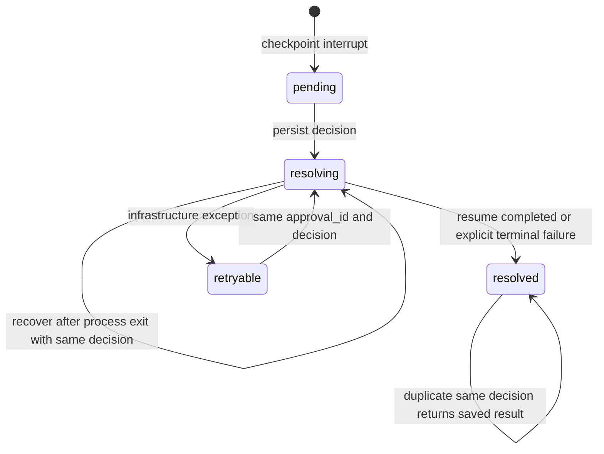

# Phase 2 Report — SkillMem Agent V1

日期：2026-10-17（Asia/Shanghai）。范围：**Stage 2 执行可靠性与 B1 统一安全基线**。

**G2技术验收：PASS。** 153项pytest全部通过，B0-compatible与B1各11/11原场景、7/7开发任务通过。新增业务持久化、幂等、审批恢复、串行执行与显式执行预算；已验证真实子进程重启及提交后进程退出恢复。本阶段付费API调用0，真实DeepSeek为`not_run`，沿用Stage 1在线验收作为历史证据。

**GitHub交付受认证阻碍：** Stage 1最终提交已在远端；本阶段代码/报告本地提交，新提交远端CI为`not_run`，不以历史CI冒充本次CI。完成后停止，等待用户审查，不进入Stage 3。

## 1. 实现摘要与范围

已实现：

- B1将业务状态与幂等回执持久化到SQLite；退款、取消、工单结果与回执原子提交，业务规则仍由原Policy和工具验证。
- 退款稳定键按客户/订单建立，跨Tool Call ID、跨重试、跨进程不重复支付；改变已完成操作的金额拒绝为幂等冲突。
- 审批journal保存pending/resolving/retryable/resolved、决定及结果；保留原`interrupt`/`Command(resume)`；checkpoint和registry间故障可重建pending。
- 单响应最多1个业务调用；多调用逐ID完整报错、零业务执行；未知工具、非法JSON/参数、重复/缺失ID有明确结果。
- 同会话串行、DB初始化串行、持久化模型/工具尝试预算、明确错误终止；不进行不受控副作用重试。
- 复用Stage 1 Trace/Usage/Oracle；新增幂等回放/Guard拒绝计数；工具观察按消息身份去重，重复call_id的不同结果不再丢失。
- B0原始及Stage 1固定锚点保留；B1为默认运行路径；评测保存实际variant与execution_limits。
- 原场景CLI失败退出1；B1中文政策关键词别名（退款/退货/取消/物流/配送/保修），没有引入RAG或完整中文对话能力。

与原方案的差异：

1. 原Stage 2规范允许业务持久化可选；本轮用户明确要求跨重启一致，因此实现SQLite业务状态与回执，而非只修内存幂等。
2. 新增115行`execution.py`集中执行预算/锁/错误规范，避免Store依赖Service或Graph。不是新框架、事件总线或Agent。
3. 业务用单行JSON快照加操作表，复用已有Order/Refund结构，避免引入ORM和大规模表迁移；代价是所有业务写入串行，适合当前小数据夹具。
4. 单Service实例保守串行所有会话，跨实例按DB/thread串行；比仅锁同thread更保守，降低共享checkpoint连接的事务风险。
5. B0与B1共同保留在代码库，原91项测试用fixture显式选择B0；新62项专门验证B1。没有删除或放宽原断言。B0权威版本仍是固定Git标签，兼容开关不能代替历史源码锚点。

未实现：Skill、TaskMemory、Context压缩/Token Budget、Planning、多Agent、真实支付、生产鉴权、分布式事务、多机锁、Stage 3–5实验。没有新增未来空模块。

## 2. Git及基线关系

| 项目 | 值 |
|---|---|
| Repository | https://github.com/njuxushuo/skillmem-agent |
| Branch | `main` |
| 开始时HEAD/main/origin/main | `0021b1d96a942bbd4259317bcfd5f494c33d7617`，fetch后相同，工作树干净 |
| 原始上游 | `b0-upstream` → `b6fe9faebff8a1af549ae7b8cabcb0b6e6479cec` |
| 原Stage 1标签 | `stage-1` → `0a8112fb157218f8e4905dfb8bff22be452e8658`，未移动 |
| B0带适配与评测/在线补充版本 | 新增`b0-compatible`与`stage-1-live-smoke` → `0021b1d96a942bbd4259317bcfd5f494c33d7617` |
| Stage 2实现提交 | `ba40a8b3d363b19e128f12c08e13752b7eaa8d48` |
| B1代码锚点 | `b1-baseline` → 上述实现提交 |
| Stage 2最终交付 | `stage-2`，包括实现、本文与脱敏证据；用`git rev-parse 'stage-2^{commit}'`核实最终SHA |
| 推送 / 本次远端CI | `not_pushed` / `not_run`：当前HTTPS写入认证不可用 |

源码提交后在干净工作树运行7个B1开发任务及重复退款Mock取证，记录`working_tree_dirty=false`、Git SHA、源码/数据/配置哈希。本文随后单独提交，不自引用尚未生成的自身SHA；最终回复提供完整交付SHA。

远端核查：`origin/main`已包含Stage 1最终改动、报告、Mock测试与真实smoke证据，故无需重复推送Stage 1 main；远端`stage-1`标签缺失，正常推送标签退出128：`could not read Username for 'https://github.com': terminal prompts disabled`。未force push、未覆盖历史、未绕过认证。本次交付后以相同正常HTTPS方式尝试推送main和阶段标签，最终状态见交付回复。

B0是来源/能力边界参考，B1才是后续M/MS的安全对照组。B0使用原控制循环，执行预算字段为null；**不得把B0/B1的可靠性差异归因为Memory/Skill收益**。后续B1/M/MS须共用相同模型、数据、预算和本阶段安全执行层；本次没有优化组，不产生消融结论。

## 3. 核心技术实现

### 3.1 SQLite业务持久化与原子幂等

`store.py:Store.persist`（143行）、`transaction`（172行）、`operation`（203行）、`remember`（215行）。

同一SQLite文件保存：

| 表 | 内容/约束 |
|---|---|
| business_state | id=1的业务快照；订单/退款/工单、客户与演示日期 |
| business_operations | operation_key主键、请求指纹、已完成结果 |
| approval_journal | approval_id主键、thread、业务详情、状态、不可覆盖的决定、缓存结果 |
| execution_turns | thread主键、本用户轮次模型/工具尝试数及预算配置 |
| conversations | 原会话归属 |
| checkpoints / writes | 原LangGraph SqliteSaver管理 |

`BEGIN IMMEDIATE → 读取最新快照 → 验证归属/政策/金额 → 查询回执 → 更新业务+写回执 → 截止检查 → COMMIT`。异常回滚数据库，并恢复本地快照；不会出现“退款已写但幂等回执未写”的半提交。业务/registry/checkpointer使用独立连接，避免一个模块提交另一个模块未结束的事务。

退款键`refund:{customer}:{order_id}`，请求指纹含客户和规范化金额。原规则每订单最多退款一次，因此不依赖模型生成的不稳定call_id；重复相同金额返回原refund_id并标记`idempotent_replay=true`；不同金额返回`idempotency_conflict`。退款理由不作为另一次支付的身份，重放返回原始已授权结果。取消键`cancel:{customer}:{order_id}`；工单键按thread/AI消息ID/tool_call_id，阻止checkpoint重放同一工单。

`tools.py:_refund_b1`（220行）在interrupt之前结束事务，**不先支付**；恢复后重新读取订单、归属、资格和金额上限再提交。`_cancel_b1`（288行）同样在写事务内重新验证未发货规则。`policy.py`逐字节未改，50欧阈值、30天窗口、订单归属与退款金额规则保留。可信低层Store方法不是外部支付API，外部业务入口仍为这些工具。

业务提交和checkpoint保存是两个边界：业务提交后进程退出或checkpoint写失败，恢复会重入工具；回执将其变成结果重放。已用真实子进程退出测试验证，未宣称真实支付服务的Exactly Once。

CLI/API默认`.local/db/support.sqlite`，均读取SUPPORT_DB；直接构造`SupportService(db_path=None)`为临时SQLite内存模式，不能声称跨重启保存。数据只在首次建库种入，重启不会重置退款；有历史会话的B0数据库没有业务事实，B1拒绝自动升级，须新库或人工对账。

### 3.2 人工审批状态机与恢复

`service.py:ConversationRegistry.journal_pending/decide/finish`、`SupportService._reconcile`（361行）、`_resolve_b1`（367行）、`retry_turn`（406行）。



- pending不再“取出后删除”。决定先提交，再调用原Command(resume)。异常保留retryable，进程退出保留resolving；重复原决定可恢复。
- 从LangGraph interrupt重建缺失journal，覆盖“checkpoint成功、pending写入失败”的窗口。
- 同一决定重复提交返回缓存ChatResult，不再请求模型或退款；不同approved/reviewer/note拒绝409。
- 同会话可能先拒绝后重新申请；此时强制approval_id，旧决定只能指向旧审批，不能批准新申请。API/CLI/runner都传递该字段。
- 恢复时如果图仍中断则Command(resume)，若已执行到后续checkpoint则invoke(None)续跑；不重新加入用户消息。
- 业务完成但模型回复失败，返回status=failed并保存真实业务结果；不会因“回复失败”反向退款或自动再次付款。基础设施异常可显式恢复，明确终止则交人工确认。
- GraphInterrupt原样传播；大额审批ToolMessage始终对应原工具ID。新状态仅表示执行终止，不伪造“待审批等于已退款”。

### 3.3 Guard、串行、预算与异常

`graph.py:guarded_tools`（112行）包装原ToolNode，保留原agent↔tools节点架构、System、8工具与40条历史策略；没有新增路由/规划模型。

- 多个调用：每个有效ID各得错误ToolMessage，当轮业务入口0；不会只执行其中一个。
- 未知工具、非法JSON、缺参数、额外身份参数、类型不符：结构化错误；可在剩余模型预算内改正。
- 缺失/重复ID无法建立可靠配对时终止，不发送下一模型请求；旧会话拒绝继续，要求新会话。
- 函数异常/超时返回配对错误并终止；错误JSON包含error/status/retryable。retryable仅表示临时性质，不触发自动副作用重试。
- `ExecutionControl.consume`在请求/尝试前把次数写入SQLite；默认每用户轮次8模型/8工具尝试，审批恢复不重置；异常退出保留已预留次数。B1拒绝SDK max_retries非0。
- 每次chat/resume默认120秒执行窗口、工具5秒截止检查，人工等待不算墙钟执行时间；工具事务过截止不提交。同步本地工具不创建超时后仍可能付款的后台任务。这是协作截止检查，**不承诺任意阻塞Python代码5秒必返回**。
- recursion_limit仅为按模型次数推导的二级保险，主要终止来自显式计数；B1递归异常返回failed，不伪装answered。
- `database_lock`用本机POSIX flock；同DB/thread跨实例/进程串行，进程退出自动释放。单Service保守串行所有会话；SQLite业务写锁另保跨会话同订单原子性。初始化锁与启动时get_tuple避免首次WAL建表竞态。

B1的`ExecutionState`只比MessagesState增加`stop_reason`；它不是Structured TaskMemory，没有订单事实、规划步骤或摘要。预算记录在执行表，不用于构建模型上下文。

### 3.4 Tracing与评测

复用`TraceRecorder`：保留模型request/response/error、真实usage、函数入口/返回/拒绝/异常/暂停/重入，增加`tool.idempotent_replay`、`execution.guard_rejected/stopped`、审批恢复状态事件。ToolMessage.id用于观测去重（首次缺失时生成），协议tool_call_id不变，重复同一call_id仍能记录两个真实结果。

`run_cases(..., variant, limits)`保留每任务独立Store/临时数据库/thread、失败后继续及最终业务Oracle；返回status failed不被算成completed。所有业务、审批、预算和checkpoint连接在case结束关闭。模型请求次数、尝试预留数、真实函数入口数不是一个概念；崩溃发生在预留后/函数前时，预算可以保守多计，绝不把它假称为实际工具执行。

## 4. 测试证据与故障修复

固定CPython3.12.9/Linux，锁定依赖未改、无新增第三方包。所有测试通过禁网入口清除API Key并禁止Python socket；子进程也主动启用该入口。

```bash
COVERAGE_FILE=.local/stage2/.coverage .venv/bin/python scripts/run_offline.py pytest -q \
  --basetemp=.local/stage2/tmp_release --cov=support_agent --cov-report=term-missing \
  --cov-report=json:.local/stage2/coverage.json
.venv/bin/python scripts/run_offline.py scenarios
.venv/bin/python scripts/run_offline.py tasks
SKILLMEM_VARIANT=B0-compatible .venv/bin/python scripts/run_offline.py scenarios
SKILLMEM_VARIANT=B0-compatible .venv/bin/python scripts/run_offline.py tasks
.venv/bin/ruff check src tests scripts
.venv/bin/ruff format --check src tests scripts
.venv/bin/python -m pip check
```

| 项目 | 真实结果 |
|---|---|
| 改动前Stage 1回归 | 91 passed in 2.91s |
| 最终全部pytest | **153 passed in 18.93s**，0失败、0跳过 |
| 保留原91项 | 所有原断言保留；conftest新增autouse fixture选择B0-compatible |
| 新增pytest | **62项：test_reliability.py 51项 + test_persistence.py 11项** |
| 原始11场景CLI | **B0 11/11、B1 11/11** |
| 7开发任务CLI | **B0 7/7、B1 7/7** |
| B0/B1配对正常任务单测 | 每变体7任务×2次=14/14；业务Oracle、SOP、提议/入口数相同，offline usage均null |
| B1 DeepSeek协议Mock | 重用3个Stage 1协议用例验证多轮ID/usage/审批/非法JSON；无真实网络 |
| 语句覆盖率 | **1400/1500 = 93.3333%**，仅应用语句，不宣称分支覆盖率 |
| Lint / format /依赖 | 全通过，26个Python文件格式通过，pip check无损坏依赖 |
| 本阶段真实API | **not_run，付费请求0**；offline/Mock用量不代表模型效果或账单 |

原11场景也被pytest调用，不能重复相加声称更多独立测试。新增3个B1 Mock用例复用了旧测试逻辑，属于不同变体配置，未冒充新的真实API实验。

关键异常证据（均有状态/次数/协议断言）：

| 覆盖项 | 测试 |
|---|---|
| 新call_id、相同call_id重复退款 | `test_repeated_refund_new_tool_ids_returns_same_receipt`、`test_reused_tool_call_id_retains_both_observations` |
| 金额变化、SQL唯一约束、取消回放 | `test_changed_amount_cannot_reuse_successful_operation`、`test_receipt_primary_key_prevents_duplicate_sql_insert`、`test_cancel_replay_is_persistent_and_has_one_receipt` |
| 实际进程重启保存退款/取消/工单 | `test_real_process_restart_preserves_refund_cancel_and_ticket` |
| 跨进程待审恢复与重复决定 | `test_real_process_restart_resumes_pending_approval_and_rejects_duplicate_payment` |
| **提交后立即进程退出再恢复** | `test_process_crash_after_refund_commit_before_graph_completion`，子进程os._exit(73)，下一进程退款仍1笔 |
| 事务中途失败与checkpoint失败 | `test_refund_and_receipt_rollback_together`、`test_checkpoint_save_failure_after_payment_replays_receipt` |
| resume前/后异常、pending写入丢失 | `test_resume_failure_preserves_decision_and_can_recover`、`test_lost_pending_write_reconstructed_from_checkpoint` |
| 批准/拒绝/重复/旧审批影响新审批 | `test_approval_decision_idempotent_and_conflicting_decision_rejected`、`test_old_decision_cannot_resolve_a_later_approval` |
| 审批后取消、金额下降、归属变化、过期 | `test_approval_revalidates_changed_business_state`四组 |
| 同thread跨实例串行、不同thread同单并发 | `test_same_thread_calls_are_serialized_across_service_instances`、`test_concurrent_different_sessions_same_order_have_one_operation` |
| 参数/多调用/不可恢复ID协议 | `test_illegal_calls_have_paired_errors_without_execution`、`test_multiple_tools_all_rejected_with_complete_protocol`、`test_duplicate_call_ids_stop_without_side_effects_and_require_new_thread` |
| 预算/超时/模型异常/重试设置 | `test_execution_budget_ends_without_recursion_fallback`、`test_approval_budget_is_not_reset_by_resume`、`test_tool_timeout_rolls_back_and_terminates_without_retry`、`test_model_error_after_refund_does_not_repeat_mutation`、`test_model_sdk_retries_cannot_bypass_b1_budget` |
| 越权、超额、未送达、过期及50欧边界 | `test_b1_preserves_ownership_window_delivery_and_amount_rules`、`test_b1_approval_threshold_boundary` |
| Runner失败后继续/退出码/原Usage | `test_budget_failure_runner_reason_and_remaining_cases`、`test_original_evaluator_failure_has_nonzero_exit`、原91项及B1协议Mock |

真实失败与修复记录：

1. 扩展测试首次`3 failed, 44 passed`：复用旧Mock测试时把tmp_path/monkeypatch位置参数反传，导致AttributeError；改用具名参数，未改生产逻辑或测试断言。
2. 首次完整覆盖率运行`1 failed, 140 passed`：两个实例首次并发执行触发SqliteSaver延迟WAL初始化锁冲突；增加DB级初始化锁并在启动时完成初始化。随后141项通过；补充边界后最终153项通过。未通过延长无限等待或删并发断言隐藏问题。
3. Ruff发现长SQL字符串、导入顺序、zip缺strict；已修正，最终全绿。

原始日志仅本地：`.local/stage2/before_pytest.log`、`expanded_tests.log`、`full_first.log`、`full_second.log`、`pytest_release.log`、`coverage.json`及`scenarios_{b0,b1}.log/tasks_{b0,b1}.log`。

## 5. 三条脱敏执行轨迹

完整事件投影：[`artifacts/stage_2_trace_samples.json`](../../artifacts/stage_2_trace_samples.json)。仅合成业务夹具；省略完整System、历史正文和无关订单，所有生命周期事件步骤保留，ID一致匿名化，原始JSONL SHA-256随样本保存。统计见[`artifacts/stage_2_summary.json`](../../artifacts/stage_2_summary.json)。

| 轨迹 | Action–Observation全过程 | 计数与结果 |
|---|---|---|
| 正常小额退款，offline，23事件 | task.start/用户→资格提议→校验后入口→eligible=true→配对ToolMessage→退款提议18 EUR→事务写退款+回执→返回REFUND-A→模型最终回复→Store由0到18、task.end | 模型3次、提议2、入口2；1笔退款，Oracle=true |
| 大额批准恢复，offline，32事件 | 资格89 EUR→退款提议→函数暂停/graph.interrupt，Store未退款→脚本批准→approval.resolving先保存决定→同call_id重入→重验并提交1笔→模型回复→approval.resolved→Store和Oracle | 模型3次、提议2、入口3、暂停1、重入1；1笔89 EUR，Oracle=true |
| 重复退款被幂等阻止，scripted Mock，32事件 | 资格→首次退款18 EUR→再次提议相同订单/金额、不同call_id→函数真实进入、读取已完成回执→返回同refund_id/idempotent_replay=true→tool.idempotent_replay→最终状态仍1笔 | 模型4次、提议3、入口3、幂等回放1；Oracle=true |

所有usage为null，来源offline或scripted Mock，不制造Token/费用数值。重复退款测试仍把第二次函数入口计入工具执行，实际付款以Store计数1为准。

取证源码为`ba40a8b…`、dirty=false；正常7任务原始run为`.local/runs/20a4406e284d4907beb21491aa83338f/`，重复Mock为`.local/stage2/evidence/5ce468cdd82e4797a46bcb92d481fc06/`。公开证据不包含完整私有日志或SQLite。其他人可通过上述离线命令及对应pytest重现行为；原始run ID、耗时会因执行不同而变化。

## 6. Architecture & Directory Audit

实际目录与本阶段变更（M修改，A新增；未列文件保持）：

```text
skillmem-agent/
├── .env.example [M] / .gitignore [M] / .github/workflows/ci.yml [M]
├── README.md [M] / LICENSE / pyproject.toml / requirements.lock
├── src/support_agent/
│   ├── store.py / tools.py / service.py / graph.py [M]
│   ├── execution.py [A]
│   ├── tracing.py / evaluation.py / evaluate.py [M]
│   ├── api.py / __main__.py / policies_kb.py [M]
│   └── models.py / policy.py / offline_model.py / __init__.py
├── tests/
│   ├── conftest.py [M，仅旧测试变体fixture]
│   ├── test_reliability.py / test_persistence.py [A]
│   └── 原test_api/conversations/policy_and_tools/deepseek/evaluation/live_smoke.py
├── data/store.json / policies.md / scenarios.json / eval_tasks.json [未改]
├── scripts/run_offline.py / run_live_smoke.py [后者M，显式固定B0避免默认值漂移]
├── docs/architecture.md / implementation_plan.md [批准规范未改]
│   ├── evaluation_protocol.md [M] / limitations.md [A]
│   └── reports/phase_0.md / phase_1.md / phase_1_live_smoke.md / phase_2.md [后者A]
└── artifacts/stage_2_summary.json / stage_2_trace_samples.json [A，旧产物保留]
```

唯一新增应用模块`execution.py`：

| 函数/类 | 输入→输出 / 依赖 |
|---|---|
| ExecutionLimits | 明确的次数/秒数配置→校验后的不可变配置 |
| database_lock | DB路径+身份→OS排他锁上下文；本机POSIX |
| ExecutionControl.start/consume | thread+操作类别+deadline→持久化预留或明确停止 |
| ExecutionControl.session | thread→本实例和跨实例同会话串行上下文 |
| check_deadline/tool_error | deadline/错误码→超时异常或结构化工具错误 |

依赖：入口→Service/Evaluation→Graph→原Tool→Policy/Store；Service/Graph/Store仅向下依赖execution标准库辅助，不存在execution反向导入或第二Agent。事务/数据留Store，政策留Policy/Tools，审批编排留Service，Guard留Graph；评测不直接伪造副作用。

应用规模：**14文件/1817行 → 15文件/2588行，净增771物理行**。测试7文件/1015行→9文件/1756行，净增741行；scripts净增1行。行数按`splitlines()`计算，基准为Stage 1最终提交0021b1d。

规模提醒：service.py424行，包含既有Registry与会话/审批编排，职责相邻；evaluation.py481行，保持原权威Oracle/runner单实现，Stage 2只增加变体/预算/失败分类；两者已到架构提醒阈值，但没有为了行数抽出无意义框架。后续增长再按实际职责考虑拆分。本次小型execution模块115行，store225、tools310、graph185；未创建state/memory/context/skills/planning空文件。

State仅增加stop_reason；B0仍用MessagesState。节点仍agent/tools，B1在工具后增加明确终止分支。checkpoint schema由原SqliteSaver管理；B0→B1数据库迁移明确拒绝自动完成，未伪称兼容旧丢失业务事实。

18份原Policy/模型/数据/规范/测试文件与0021逐字节一致；所有原测试断言保留。MIT和来源说明保留，研究快照未操作。Key与运行DB/原始JSONL/.env/锁目录均被忽略；提交前对跟踪与候选文件进行凭据模式及本地Key精确匹配检查，无命中（不打印值）。完整真实API旧账本未重跑。

## 7. 风险与Stage 3前置条件

- 已验证本机子进程重启和进程退出；未验证断电/损坏/NFS/多机/生产支付。业务快照单行写入适合轻量夹具，非大型交易库。
- 工具超时是同步协作截止，不能强杀任意阻塞函数；外部真实工具若未来引入，必须提供自身超时/幂等合同。没有将线程future超时误当成已取消付款。
- B0数据库业务记录缺失，不能直接升级；本阶段选择拒绝混用，后续真实数据迁移须单独设计。
- 单Service串行所有请求影响吞吐；锁文件和审批历史未做清理，适合当前低负载研究场景。身份Header/员工共享Key仍不是生产鉴权。
- 终止后的failed与业务是否已退款是两个维度，运营侧必须查看回执，不可盲目重新付款。非审批retry_turn暂为服务维护接口，未新增HTTP恢复入口。
- B1真实LLM行为本阶段未测；Stage 1在线PASS仅说明之前的适配，不能充作B1在线成功率。后续真实评测需另行授权预算。
- GitHub推送认证仍缺失，无法验证本次远端CI；本地已执行CI同口径检查。

**技术上已满足G2并可提交Stage 3审查；必须等用户明确批准才能开始。** Stage 3需保持B1独立可运行、共用本阶段可靠执行和预算，并新增Memory/Context专项测试；不得把本阶段修复计入优化收益。

## 8. G2 Gate

| 验收项 | 判定 | 证据 |
|---|---|---|
| 原91pytest、11场景、7任务保留 | PASS | 153全绿；旧91固定B0断言；B0/B1各11/7 |
| 同订单重复退款/取消无重复副作用 | PASS | 新/旧call ID回放、金额冲突、唯一主键、并发同单 |
| 业务写事务与服务重启一致 | PASS | 完整快照+回执同事务；子进程重启/退出恢复；回滚测试 |
| 大额批准/拒绝/重复决定可靠 | PASS | pending→resolving→resolved/retryable；决定不可覆盖；approval_id隔离 |
| resume失败不丢pending | PASS | 前后故障、缺失registry重建、提交后退出、checkpoint失败 |
| 超额、越权、窗口与50欧阈值 | PASS | B1直接工具异常注入，原Policy未改 |
| 非法工具/参数/多调用完整协议 | PASS | 全ID报错、零业务执行；不可配对ID明确终止 |
| 同会话串行及跨会话业务原子性 | PASS | 双实例并发断言、SQLite事务；初始化竞态修复 |
| 预算、模型错误、工具超时安全终止 | PASS | 持久化次数、resume不重置、SDK重试拒绝、事务超时回滚 |
| Tracing/Usage/Oracle兼容 | PASS | 原测试、B1协议Mock、重复call_id双观察与回放计数 |
| B0/B1可追溯、后续统一安全基线 | PASS | 固定标签/提交与显式variant，B1唯一Guard/执行实现；M/MS尚未创建 |
| 架构/秘密隔离/离线要求 | PASS | 单package、无后续模块、新execution职责审计；付费调用0 |
| 报告/本地版本记录 | PASS | 实现提交、最终stage-2、3条脱敏证据 |
| GitHub推送与本次CI | BLOCKED / not_run | 缺正常HTTPS写入凭据，保留本地历史，未强推 |

**Stage 2到此完成并停止，等待审查；不自动进入Stage 3。**
